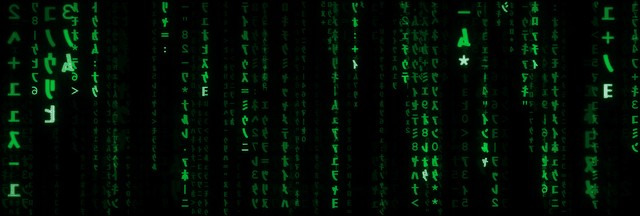

# Matrix Screensaver

[English](README.md) · **Español**

La lluvia digital de *The Matrix* como protector de pantalla para Windows, escrito en Python. Renderizado en GPU, multimonitor, sensible al DPI y configurable.

**Web y guía de instalación:** https://madkoding.github.io/matrix-screensaver/es/



*Clip de demostración en bucle del protector en funcionamiento.*


*Captura real de una configuración de 3 monitores (un ultrapanorámico central y dos pantallas verticales).*

| Detalle | Mensaje escrito |
|---|---|
|  |  |

## Características

- **Renderizado en GPU (OpenGL):** toda la lluvia se calcula en un fragment shader, así que se sincroniza con la frecuencia de tus pantallas. Genera unos 700 FPS sin tope en una RTX 3060 con tres monitores (7,8 millones de píxeles), es decir, muchísimo margen. Un renderizador por software toma el relevo automáticamente cuando no hay OpenGL (Escritorio remoto, algunas máquinas virtuales).
- **Multimonitor y sensible al DPI:** cada pantalla ejecuta su propia lluvia, ajustada a su resolución, posición y escala de Windows. Conectar o desconectar una pantalla mientras funciona se detecta automáticamente.
- **Glifos de la película:** katakana de medio ancho en espejo (MS Gothic) más dígitos y símbolos en Courier New Bold.
- **Cabeza brillante y estela:** el glifo líder es casi blanco, la estela se desvanece pasando por el verde fósforo y los glifos mutan al azar.
- **Profundidad:** tres capas con paralaje (una lejana, tenue y lenta; una intermedia; y una cercana, grande y desenfocada).
- **Bloom real:** desenfoque multiescala de todo el fotograma, no solo un halo por glifo.
- **Aspecto de CRT:** scanlines con interlazado animado (los campos par/impar se alternan en cada fotograma), viñeteado y un parpadeo sutil.
- **Mensajes escritos:** de vez en cuando *"Wake up, Neo..."* y compañía se escriben solos sobre la lluvia.
- **Colores:** `film`, `classic`, `amber`, `red`, `blue`, `white`.
- **Ventana de ajustes** y **vista previa** en vivo en el selector de protectores de pantalla de Windows.
- **Escalado AMD FSR 1.0 opcional:** renderiza al 67 %, 59 % o 50 % de la resolución por eje y escala con un port a GLSL de EASU + RCAS de AMD (desactivado por defecto). La lluvia es un shader tan barato que en una GPU rápida FSR cuesta más de lo que ahorra (unos 700 FPS nativos frente a 470-530 con FSR en una RTX 3060), así que está pensado para GPUs débiles o integradas y resoluciones muy altas. Las scanlines, el interlazado y el parpadeo se aplican después del escalado para que sigan siendo una fila real de un píxel de grosor.
- **Sincronizado con tus monitores:** los fotogramas se limitan a la frecuencia de la pantalla más rápida (60, 75, 144 Hz...) con un limitador preciso, para no gastar GPU sin necesidad. Con batería baja a 30 FPS.
- Se cierra con cualquier tecla, clic o movimiento del ratón.

## Descarga

Descarga `MatrixRain.scr` desde la [última versión](../../releases/latest), haz clic derecho sobre el archivo y elige **Instalar**. Windows abre el selector de protectores de pantalla con él ya seleccionado; usa **Configuración...** ahí para ajustar el aspecto.

> El archivo no está firmado digitalmente (hace falta un certificado de pago), así que Windows SmartScreen o un antivirus pueden avisar, algo habitual en los ejecutables de PyInstaller. Puedes revisar el código fuente aquí y compilarlo tú mismo.

## Ajustes

Abre **Configuración...** en el selector de protectores de pantalla. Los valores se guardan en `%APPDATA%\MatrixRain\settings.json`.

| Ajuste | Qué hace |
|---|---|
| `color` | Preajuste de color: film, classic, amber, red, blue, white. |
| `bloom` | Intensidad del brillo, de 0 a 1 (0 lo desactiva). |
| `scanlines` | Oscuridad de las scanlines, de 0 a 0,9. |
| `interlace` | Alterna los campos par/impar de las scanlines en cada fotograma. |
| `vignette` | Oscurecimiento de las esquinas, de 0 a 1. |
| `flicker` | Pequeña variación global de brillo (renderizador GPU). |
| `speed` / `density` | Velocidad de caída y cantidad de columnas simultáneas. |
| `glyph_scale` | Multiplicador del tamaño de los glifos. |
| `trail_falloff` | Qué tan rápido se desvanece la estela tras su cabeza (más alto = más corta). |
| `depth` | Tres capas con paralaje en lugar de una. |
| `easter_egg` | Mensajes escritos ocasionales. |
| `renderer` | `auto`, `gpu` o `software`. |
| `upscaling` | AMD FSR 1.0: `off` (por defecto), `quality` (1,5x), `balanced` (1,7x) o `performance` (2x). Solo renderizador GPU. |
| `sharpness` | Afilado de FSR en pasos (stops): 0 es lo más nítido, 2 lo más suave (el valor de AMD es 0,2). |
| `font_path` | TTF/OTF opcional para usar en todos los glifos. |

### Usar la fuente de la película

La fuente original del código no está incluida (las fuentes tienen sus propias licencias). Si tienes una TTF/OTF estilo Matrix que puedas usar, elígela en el diálogo de ajustes o déjala en una carpeta `fonts` junto al `.scr`; reemplaza a MS Gothic/Courier en todos los glifos.

## Compilar desde el código

Requiere Windows y Python 3.10+.

```powershell
python -m pip install -r requirements.txt pyinstaller
.\build.ps1
```

Esto genera `MatrixRain.scr`. Subir una etiqueta `v*` lo compila en GitHub Actions y lo adjunta al release (ver `.github/workflows/release.yml`).

### Ejecutar directamente con Python

```powershell
python matrix_saver.py /s
```

Opciones de desarrollo:

| Opción | Efecto |
|---|---|
| `--seconds N` | Sale tras N segundos e ignora la entrada. |
| `--shot ARCHIVO` | Guarda una captura justo antes de salir. |
| `--renderer gpu\|software` | Fuerza un renderizador. |

Ejemplo: `python matrix_saver.py /s --seconds 8 --shot captura.png`

> Nota: ejecutar un `.scr` con `Start-Process` o doble clic hace que Windows añada `/S` y descarte tus argumentos. Lánzalo directamente desde una terminal para pasar opciones.

## Cómo funciona

| Archivo | Función |
|---|---|
| `matrix_saver.py` | Punto de entrada: análisis de argumentos (`/s`, `/c`, `/p`), bucle principal, detección de monitores conectados y de batería. |
| `gl_renderer.py` | Ruta GPU: shader procedural de la lluvia, atlas de glifos, cadena de bloom, composición final, FSR opcional y el pase de scanlines posterior al escalado. |
| `fsr.py` | AMD FSR 1.0 (EASU + RCAS) autónomo y reutilizable para moderngl, compartido con el protector de acuario. |
| `soft_renderer.py` | Respaldo por CPU con el mismo aspecto. |
| `settings.py` | Valores por defecto, persistencia JSON y constantes de aspecto compartidas. |
| `config_dialog.py` | Ventana de ajustes en Tk. |
| `winapi.py` | Monitores con DPI por pantalla, estado de energía, instancia única, incrustación de la vista previa. |
| `glyphs.py` | Conjunto de glifos y carga de fuentes. |
| `easter_egg.py` | Temporización de los mensajes escritos. |

- Un `.scr` es solo un `.exe` renombrado; Windows lo lanza con `/s` (ejecutar), `/c` (configurar) o `/p HWND` (vista previa). [PyInstaller](https://pyinstaller.org) empaqueta el script.
- Una sola ventana sin bordes cubre todo el escritorio virtual. El shader averigua a qué monitor pertenece un píxel y dibuja la cuadrícula de ese monitor, así que funcionan tamaños, orientaciones y escalas mezclados.
- El estado de cada columna es una función pura del tiempo y de un hash de su posición, así que la CPU no simula nada por fotograma.
- Los glifos viven en un único atlas con mipmaps; la capa cercana desenfocada es simplemente un nivel de mip más grueso.
- El bloom reduce el fotograma a 1/4 y 1/16 de resolución, desenfoca cada uno y los suma de nuevo antes del viñeteado y del pase de scanlines.

## Requisitos

- Windows 10/11
- Las fuentes `msgothic.ttc` y `courbd.ttf` (vienen con Windows)
- Python 3.10+, `pygame-ce`, `numpy`, `moderngl` (solo para ejecutarlo desde el código)

## Licencia

Copyright (C) 2026 madkoding. Este proyecto es software libre, publicado bajo la [Licencia Pública General de GNU v3.0](LICENSE): puedes usarlo, estudiarlo, compartirlo y modificarlo, y redistribuir versiones modificadas bajo la misma licencia. Los componentes de terceros conservan sus propias licencias; consulta [THIRD_PARTY_NOTICES.md](THIRD_PARTY_NOTICES.md).

## Créditos

- El escalado se basa en AMD FidelityFX Super Resolution 1.0 (licencia MIT); consulta [THIRD_PARTY_NOTICES.md](THIRD_PARTY_NOTICES.md).
