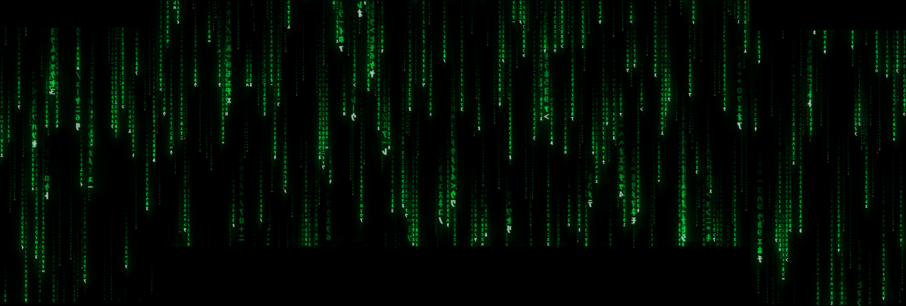
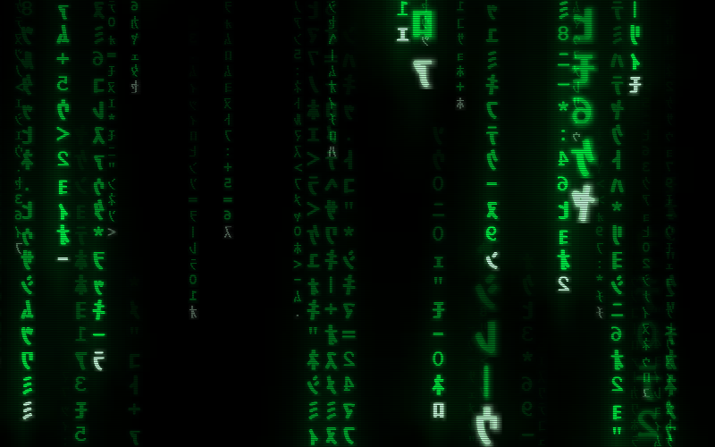
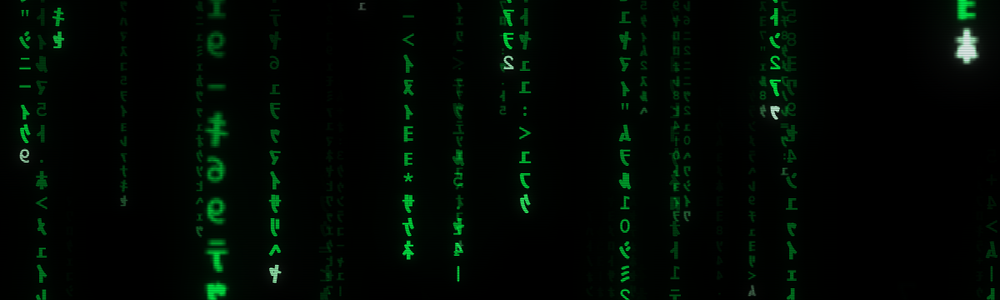

# Matrix Screensaver

The digital rain from *The Matrix* as a Windows screensaver, written in Python. GPU-rendered, multi-monitor, DPI-aware, and configurable.



*Real capture from a 3-monitor setup (a central ultrawide plus two portrait displays).*

| Detail | Typed message |
|---|---|
|  |  |

## Features

- **GPU rendering (OpenGL):** the whole rain is computed in a fragment shader, so it locks to your displays' refresh rate. It renders 200+ FPS uncapped on an RTX 3060 across three monitors (7.8 million pixels), so there is plenty of headroom. A software renderer takes over automatically when OpenGL isn't available (Remote Desktop, some VMs).
- **Multi-monitor and DPI-aware:** every display runs its own rain, fitted to its resolution, position and Windows scaling. Plugging or unplugging a display while it runs is picked up automatically.
- **Film glyphs:** mirrored half-width katakana (MS Gothic) plus digits and symbols in Courier New Bold.
- **Bright head and trail:** the leading glyph is almost white, the trail fades through phosphor green, and glyphs randomly mutate.
- **Depth:** three parallax layers (a dim, slow far layer, a middle layer, and a large out-of-focus near layer).
- **Real bloom:** multi-scale blur of the whole frame, not just a halo per glyph.
- **CRT look:** scanlines with animated interlacing (even/odd fields alternate every frame), vignette and a subtle flicker.
- **Typed messages:** now and then *"Wake up, Neo..."* and friends type themselves out over the rain.
- **Colors:** `film`, `classic`, `amber`, `red`, `blue`, `white`.
- **Settings dialog** and a live **preview** in the Windows screensaver picker.
- **Paced to your monitors:** frames are capped at the fastest display's refresh rate (60, 75, 144 Hz...) with a precise limiter, so it doesn't burn GPU for nothing. On battery it drops to 30 FPS.
- Exits on any key press, click, or mouse movement.

## Download

Grab `MatrixRain.scr` from the [latest release](../../releases/latest), then right-click it and choose **Install**. Windows opens the screensaver picker with it already selected; use **Settings...** there to tweak the look.

> The file is not code-signed (that needs a paid certificate), so Windows SmartScreen or an antivirus may warn about it, as is common with PyInstaller executables. You can inspect the source here and build it yourself.

## Settings

Open **Settings...** in the screensaver picker. Values are stored in `%APPDATA%\MatrixRain\settings.json`.

| Setting | What it does |
|---|---|
| `color` | Color preset: film, classic, amber, red, blue, white. |
| `bloom` | Glow strength, 0 to 1 (0 disables it). |
| `scanlines` | Scanline darkness, 0 to 0.9. |
| `interlace` | Alternate the even/odd scanline fields every frame. |
| `vignette` | Corner darkening, 0 to 1. |
| `flicker` | Subtle global brightness jitter (GPU renderer). |
| `speed` / `density` | Fall speed and number of simultaneous columns. |
| `glyph_scale` | Glyph size multiplier. |
| `trail_falloff` | How fast a trail fades behind its head (higher = shorter). |
| `depth` | Three parallax layers instead of one. |
| `easter_egg` | Occasional typed messages. |
| `renderer` | `auto`, `gpu` or `software`. |
| `font_path` | Optional TTF/OTF to use for every glyph. |

### Using the film's font

The original code font isn't bundled (fonts carry their own licenses). If you have a Matrix-style TTF/OTF you're allowed to use, either pick it in the settings dialog or drop it in a `fonts` folder next to the `.scr`; it replaces MS Gothic/Courier for all glyphs.

## Build from source

Requires Windows and Python 3.10+.

```powershell
python -m pip install -r requirements.txt pyinstaller
.\build.ps1
```

This produces `MatrixRain.scr`. Pushing a `v*` tag builds it on GitHub Actions and attaches it to the release (see `.github/workflows/release.yml`).

### Run directly from Python

```powershell
python matrix_saver.py /s
```

Dev flags:

| Flag | Effect |
|---|---|
| `--seconds N` | Exit after N seconds and ignore input. |
| `--shot FILE` | Save a screenshot right before exiting. |
| `--renderer gpu\|software` | Force a renderer. |

Example: `python matrix_saver.py /s --seconds 8 --shot capture.png`

> Note: running a `.scr` through `Start-Process` or double-click makes Windows append `/S` and drop your arguments. Launch it directly from a shell to pass flags.

## How it works

| File | Role |
|---|---|
| `matrix_saver.py` | Entry point: argument parsing (`/s`, `/c`, `/p`), main loop, hot-plug and battery handling. |
| `gl_renderer.py` | GPU path: procedural rain shader, glyph atlas, bloom chain, final composite. |
| `soft_renderer.py` | CPU fallback with the same look. |
| `settings.py` | Defaults, JSON persistence and the shared look constants. |
| `config_dialog.py` | Tk settings window. |
| `winapi.py` | Monitors with per-monitor DPI, power status, single instance, preview embedding. |
| `glyphs.py` | Glyph set and font loading. |
| `easter_egg.py` | Timing of the typed messages. |

- A `.scr` is just a renamed `.exe`; Windows launches it with `/s` (run), `/c` (configure) or `/p HWND` (preview). [PyInstaller](https://pyinstaller.org) packages the script.
- A single borderless window covers the whole virtual desktop. The shader looks up which monitor a pixel belongs to and draws that monitor's own grid, so mixed sizes, orientations and scaling work.
- Each column's state is a pure function of time and a hash of its position, so nothing is simulated per frame on the CPU.
- Glyphs live in one mip-mapped atlas; the out-of-focus near layer is just a coarser mip level.
- Bloom downsamples the frame to 1/4 and 1/16 resolution, blurs each, and adds them back before the vignette and scanline pass.

## Requirements

- Windows 10/11
- Fonts `msgothic.ttc` and `courbd.ttf` (shipped with Windows)
- Python 3.10+, `pygame-ce`, `numpy`, `moderngl` (only to run from source)
